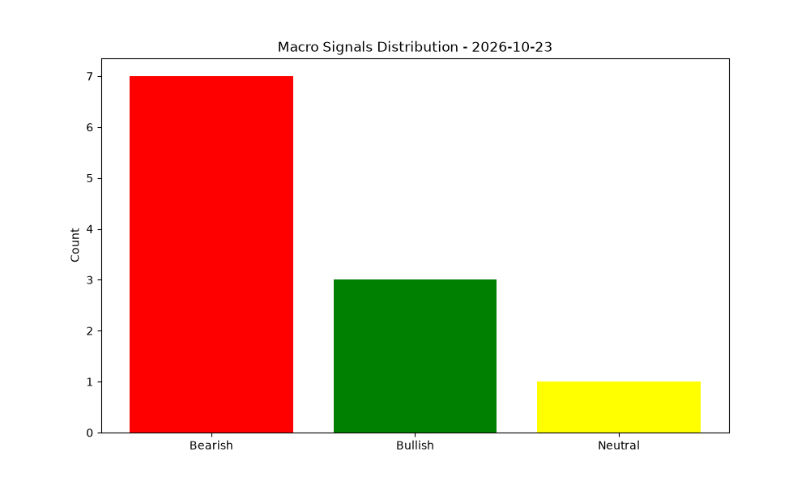

# Macro Dashboard - 2026-10-12

## Current Regime: PRE-STRESS ⚠️

### Indicator Summary

| Indicator | Value | Signal | Explanation | Data Date | Source |
|-----------|-------|--------|-------------|-----------|--------|
| 10Y Treasury Yield | 5.22 | 🔴 Bearish | Rates up 60.0bps over 3m, tightening pressure | 2026-10-08 | FRED |
| 10Y Term Premium | 1.085 | 🔴 Bearish | Elevated term premium (1.08%): investors demanding credibility compensation | 2026-10-02 | NY Fed ACM via FRED |
| 2s10s Yield Curve | 0.44 | 🔴 Bearish | Bear steepening (Spread up, 10Y up) - credibility concerns | 2026-10-09 | FRED |
| Fed Balance Sheet | 6747560.0 | 🟢 Bullish | Fed balance sheet expanding (+$6.9B over 4w) | 2026-10-07 | FRED |
| Bank Reserves | 3029659.0 | 🟡 Neutral | Bank reserves stable ($+38.3B over 4w) | 2026-10-07 | FRED (WRESBAL) |
| Treasury Auctions | 2.72 | 🔴 Bearish | Weak demand (Avg of 5): BTC 2.72, Tail 4.1bps | 2026-10-08 | Treasury Fiscal Data |
| High Yield Credit Spread | 3.15 | 🟡 Neutral | HY spreads at 315 bps, stable | 2026-10-08 | FRED (ICE BofA) |
| Bank Stress | -8.19 | 🔴 Bearish | Banks underperforming S&P 500 by 8.2% | 2026-10-12 | Yahoo Finance (KRE vs SPY) |
| 30Y Mortgage Rate | 7.4 | 🔴 Bearish | Mortgage rates up 85 bps over 3m, housing headwind | 2026-10-08 | FRED (Freddie Mac) |
| Equity Breadth | 60.0 | 🟡 Neutral | Average participation: 60.0% of stocks above 200DMA | 2026-10-12 | S&P 500 (Scraped via Wikipedia/Yahoo) |
| Gold vs Real Rates | 4192.6 | 🔴 Bearish | Rising real rates (+0.32%) pressuring gold (-3.7%) | 2026-10-08 | Yahoo (Gold) / FRED (TIPS) |

*Auto-generated by Macro Dashboard Bot*